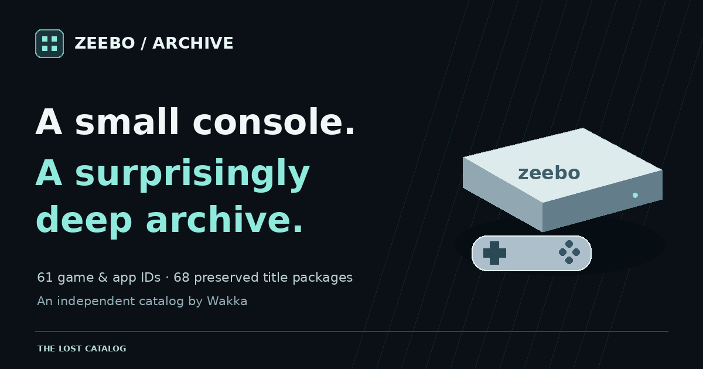

# Zeebo / Archive

**A true archive of the game and its history, not just a file.**

[Browse the archive](https://wakkatobakka.github.io/zeebo-archive/) · [Platform history](history/index.html) · [Creators](creators/index.html) · [Sources](sources/index.html)

Created and maintained by **Wakkatobakka**. Read about Zeebo games, the people who made them, and the console they worked with. Original file records remain available on each entry.



## This edition — v3.0

- **56 games, 5 applications and 20 tools or reference records**, preserving all 81 existing record URLs.
- **145 named contributors and 50 studios or organisations**, with 259 selected role credits across 37 entries. Original-game and Zeebo adaptation credits identify their edition.
- **294 source records**, including developer accounts, interviews, announcements, credit transcriptions, guide references and the original file inventory.
- **34 images across 13 game/app entries, plus 3 platform artifacts**. Creator portfolios, interfaces, promotional material, later portraits and emulator captures retain their specific labels and credits.
- **88 original source-file records**, with package variants, source paths, direct-member inventories and fingerprints retained unchanged.
- **14 printed-guide scan locators**, with guide coverage for 39 title IDs. Full-resolution scans remain at their source.

Entries use the same reading structure as the revised ExEn archive: the game, development, people, release and reception, gallery, files and sources. Sections appear when supported by research. The existing Zeebo colours are preserved.

Search by game, creator, studio, ID, filename, member path or checksum. Filters cover games, applications, tools, documents, source subset and printed-guide coverage. Contributor profiles link to their games and sources. Images can be enlarged without leaving an entry.

The expanded research includes original Portuguese and Spanish voices with labelled English translations, contemporary regional reviews, firsthand developer accounts and corrected edition-specific credits. Research decisions and unresolved leads travel with the project in [research/STATUS.md](research/STATUS.md). Read [AGENTS.md](AGENTS.md) and [ARCHIVE_STANDARD.md](ARCHIVE_STANDARD.md) before further work.

## Sources and file records

Original preservation credits belong to **OpenZeebo and the Internet Archive community**. The printed guide is credited to **Zeebo Brasil S.A.** See [methods and credits](about/index.html).

The 61 game/app IDs represent 68 title packages; they are not 61 retail games. Bundled IMICRO3D component ID 12875 remains part of Action Hero 3D. Files in the developer collection are not automatically identified as Zeebo releases.

The original inventory matched all 88 catalogued source files to Internet Archive manifest sizes and SHA-1 values. SHA-256 fingerprints and direct-member inventories are retained. No game or developer utility was executed for this catalog. Internal BAR, PAK and GGZ containers were not exhaustively decoded.

| File | Contents |
| --- | --- |
| [catalog.json](data/catalog.json) | Unchanged original inventory and provenance |
| [catalog.csv](data/catalog.csv) | 81 original browsing records |
| [packages.csv](data/packages.csv) | 88 original source files |
| [contents.csv](data/contents.csv) | Original direct-member inventories and fingerprints |
| [research.json](data/research.json) | Histories, scoped credits, quotations, sources and image attribution |
| [credits.csv](data/credits.csv) | Selected personal roles and source links |

Game binaries, executable developer tools and full guide scans are not bundled in this website.

## Updating the site

The site is static and works on GitHub Pages without a build step. Upload the extracted website files at the repository root. See [UPLOAD_TO_GITHUB.txt](UPLOAD_TO_GITHUB.txt).

To regenerate pages after editing research, use Python 3.9 or newer:

```sh
python3 tools/build_site.py
python3 tools/verify.py
```

The builder reads the original inventory and the new research separately. The verifier checks the protected inventory and palette, all generated local links and anchors, citation references, credit exports, image metadata and package/member evidence. See [data/SCHEMA.md](data/SCHEMA.md) for the research format.

Report corrections through [GitHub Issues](https://github.com/Wakkatobakka/zeebo-archive/issues), including the record ID and a supporting source.
