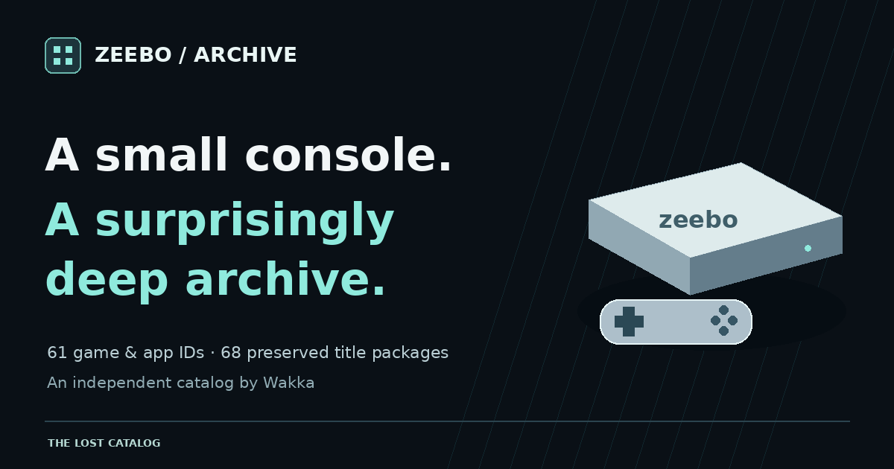

# Zeebo / The Lost Catalog

**A small console. A surprisingly deep archive.**

[**Browse the Zeebo archive →**](https://wakkatobakka.github.io/zeebo-archive/) · [Sources and story](https://wakkatobakka.github.io/zeebo-archive/about/) · [Original collection](https://archive.org/details/zeebo-romset-and-devtools)

Created and maintained by **Wakkatobakka**. Explore the surviving Zeebo collection by name, compare preserved package variants, and follow the evidence back to its source.

## Explore the collection

- **61 game/app IDs**, mapped using the 2011 OpenZeebo title list.
- **68 title packages**, with variants grouped on the same title page.
- **20 tools and reference records**, including 16 developer/support files, a printed guide, and three source-text records.
- **14 scanned guide spreads indexed**, with original summaries for **39 documented title IDs**.
- **81 browsing records and 88 source-file fingerprints**, with direct-member inventories and SHA-256 values.
- Search by title, ID, original path, internal filename, or package fingerprint; filter by record type, source subset, or guide coverage.

This catalog contains metadata, original summaries, decorative artwork, and source links. Original game binaries, developer tools, guide scans, and PDFs remain at their source.

## Sources and counting rules

Original preservation credits belong to **OpenZeebo and the Internet Archive community**. The printed game guide is credited to **Zeebo Brasil S.A.**

All 88 cataloged source files match sizes and SHA-1 values in the Internet Archive manifest embedded in the supplied archive. SHA-256 values were measured independently. Input-archive and manifest fingerprints remain in `data/catalog.json`.

The 61 game/app IDs include system applications; they are not a claim of 61 retail games. Bundled IMICRO3D component ID 12875 is not counted as an additional game. Material under the developer folder is not automatically classified as a Zeebo release.

The printed guide is undated. The English OpenZeebo readme is dated October 23, 2011. Guide descriptions identify advertised products, rather than authenticating exact executable revisions. No preserved game or utility was run for this catalog.

## Follow the records

| File | Contents |
| --- | --- |
| [Catalog CSV](data/catalog.csv) | 81 title/reference records |
| [Package CSV](data/packages.csv) | 88 source files, including title variants |
| [Contents CSV](data/contents.csv) | Direct regular archive members, with SHA-256 values |
| [Complete JSON](data/catalog.json) | Nested catalog and source provenance |

Directories are excluded from file counts. Internal BAR, PAK, and GGZ containers were not exhaustively decoded. Content-multiset fingerprints compare file bytes and sizes while ignoring member names and order.

## Errors and broken links

Report an incorrect detail, missing credit, or broken link through [GitHub Issues](https://github.com/Wakkatobakka/zeebo-archive/issues). Include the title or record ID and a supporting source where possible. Wakka reviews reports and publishes any updates.

## More from Wakka's archive

[Qualcomm BREW](https://wakkatobakka.github.io/qualcomm-brew-archive/) · [Zeebo](https://wakkatobakka.github.io/zeebo-archive/) · [ExEn](https://wakkatobakka.github.io/exen-game-archive/) · [DoJa](https://wakkatobakka.github.io/doja-archive/)

---
Independent catalog by Wakkatobakka. No affiliation with Zeebo, Tectoy, Qualcomm, or original rights holders. Original third-party content retains its respective ownership.
